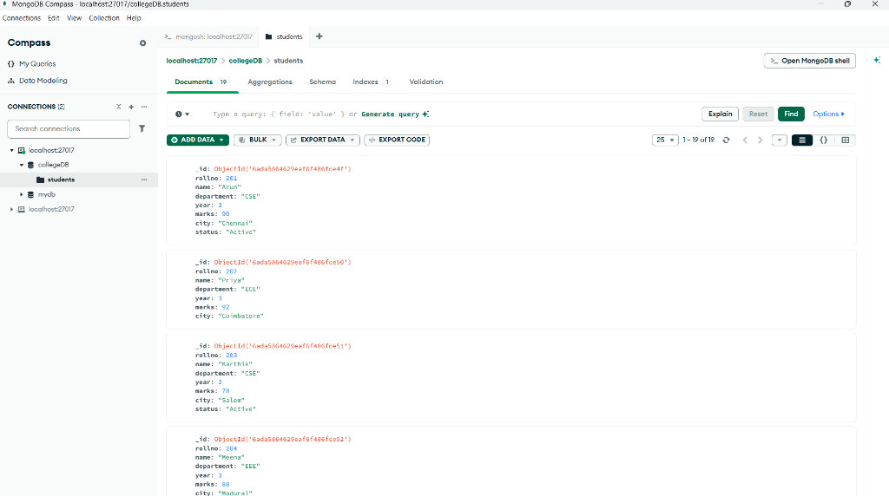

# Experiment 9: Working with MongoDB Using Shell Commands & MongoDB Compass

**Course:** Web Technology Laboratory  
**Register Number:** URK24CS1158  
**Student Name:** Gautham Manoj  
**Date of Exercise:** 25.09.2026  
**GitHub Host Link:** [https://gautham75.github.io/Web-Technology-Lab/](https://gautham75.github.io/Web-Technology-Lab/)

---

## 🎯 Aim
To study MongoDB and perform basic database operations using MongoDB Shell (`mongosh`) and MongoDB Compass, including database and collection creation, document insertion, retrieval, filtering, sorting, updating, deletion, indexing, and aggregation pipelines.

---

## 🖥️ MongoDB Compass GUI Interface

Below is the verified screenshot of the `collegeDB` database and `students` collection visualized in **MongoDB Compass**:



- **Database:** `collegeDB`
- **Collection:** `students`
- **Document Count:** 19 Documents
- **Fields:** `_id`, `rollno`, `name`, `department`, `year`, `marks`, `city`, `status`

---

## 📊 Relational Database vs. MongoDB Mapping

| Relational Database (RDBMS) | MongoDB (NoSQL) |
| :--- | :--- |
| Database | Database |
| Table | Collection |
| Row | Document (BSON / JSON) |
| Column | Field |
| Primary Key | `_id` (ObjectId) |

---

## 📁 Folder Contents

```
Experiment 9/
├── queries.mongodb.js           # Full executable MongoDB script (CRUD, Filters, Aggregations)
├── students.json                # Complete dataset with 19 student documents
├── mongodb_compass_experiment9.png # Verified MongoDB Compass GUI screenshot
├── README.md                    # Detailed documentation and query guide
└── WT LAB Experiment 9 1158.docx# Lab Record Document
```

---

## ⚡ Key Shell Commands & Operations

### 1. Database & Collection Setup
```javascript
// Check visible databases
show dbs;

// Switch to / Create collegeDB
use collegeDB;

// Create students collection
db.createCollection("students");
```

### 2. Document Insertions (Create)
```javascript
// Insert Single Document
db.students.insertOne({
  rollno: 201,
  name: "Arun",
  department: "CSE",
  year: 3,
  marks: 90,
  city: "Chennai",
  status: "Active"
});

// Insert Multiple Documents
db.students.insertMany([ ... ]);
```

### 3. Querying & Filtering (Read)
```javascript
// Find all documents
db.students.find();

// Find by Department
db.students.find({ department: "CSE" });

// Comparison Operators ($gt, $gte, $lt, $lte, $ne)
db.students.find({ marks: { $gt: 80 } });

// Logical Operators ($or, $and)
db.students.find({
  $or: [
    { department: "CSE" },
    { department: "ECE" }
  ]
});

// Projection (include only name and marks, omit _id)
db.students.find({}, { name: 1, marks: 1, _id: 0 });

// Sorting & Limiting (Top 3 highest marks)
db.students.find().sort({ marks: -1 }).limit(3);
```

### 4. Updating Documents (Update)
```javascript
// Update marks for a specific student
db.students.updateOne(
  { rollno: 201 },
  { $set: { marks: 95 } }
);

// Add 'status: Active' to all CSE students
db.students.updateMany(
  { department: "CSE" },
  { $set: { status: "Active" } }
);
```

### 5. Deleting Documents (Delete)
```javascript
// Delete single document
db.students.deleteOne({ rollno: 213 });

// Delete matching records
db.students.deleteMany({ marks: { $lt: 65 } });
```

### 6. Aggregation Pipeline
```javascript
// Department-wise average, maximum, and student count
db.students.aggregate([
  {
    $group: {
      _id: "$department",
      studentCount: { $sum: 1 },
      avgMarks: { $avg: "$marks" },
      maxMarks: { $max: "$marks" }
    }
  },
  { $sort: { avgMarks: -1 } }
]);
```

### 7. Indexing
```javascript
// Create unique index on rollno
db.students.createIndex({ rollno: 1 }, { unique: true });

// View indexes
db.students.getIndexes();
```

---

## 🚀 How to Run Locally

### Using MongoDB Shell (`mongosh`):
1. Start the MongoDB daemon:
   ```bash
   mongod
   ```
2. In terminal, load the script into mongosh:
   ```bash
   mongosh collegeDB "Experiment 9/queries.mongodb.js"
   ```

### Using MongoDB Compass:
1. Connect to `mongodb://localhost:27017`.
2. Click **Create Database** $\rightarrow$ Database Name: `collegeDB`, Collection Name: `students`.
3. Click **Add Data** $\rightarrow$ **Import JSON** $\rightarrow$ Select `Experiment 9/students.json`.
4. Run queries in the Filter bar (e.g. `{ department: "CSE", marks: { $gte: 80 } }`).

---

## 👤 Author
- **Gautham Manoj** ([@gautham75](https://github.com/gautham75))
- **Register Number**: URK24CS1158
- **Course**: Web Technology Laboratory
